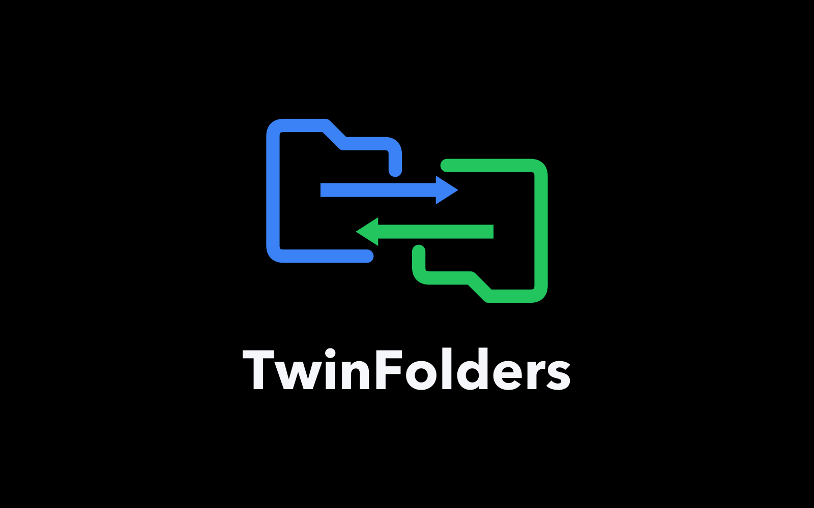
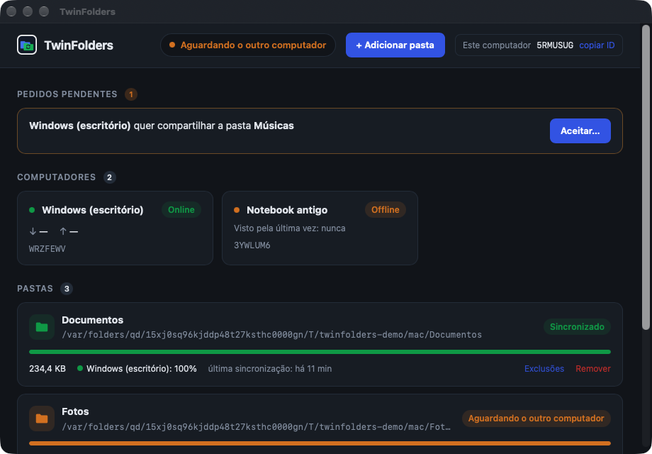
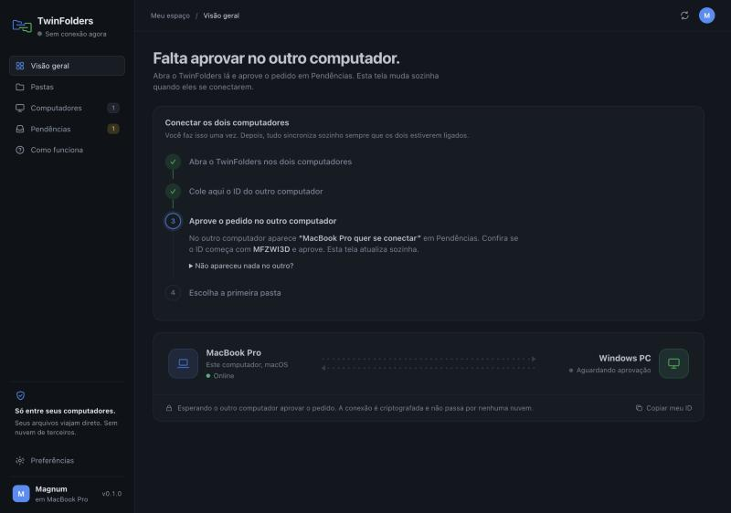

<p align="center"></p>

# TwinFolders

"Dropbox privado" entre um PC **Windows** e um **Mac**: as mesmas pastas nos dois computadores, sincronizadas direto entre eles (sem nuvem de terceiros), com **SSH** integrado e funcionando em segundo plano.

> **Status: em desenvolvimento (pré-alfa).** Núcleo, pareamento, serviço em segundo plano, painel (Tauri) e resolução de conflitos funcionam e têm testes. Faltam SSH via Tailscale e o instalador. Veja [docs/TASKS.md](docs/TASKS.md).

<p align="center"></p>

## Como funciona

O TwinFolders **não reinventa a sincronização**. Ele orquestra ferramentas maduras e cuida da configuração segura:

| Peça | Papel |
|---|---|
| [Syncthing](https://syncthing.net) | Sincronização P2P, retomada automática quando os dois voltam a ficar online, versionamento e conflitos |
| [Tailscale](https://tailscale.com) | Rede privada entre as máquinas, em qualquer rede, **sem abrir portas no roteador** |
| OpenSSH | Terminal remoto entre as máquinas, só por chave |
| Tauri (em breve) | App na barra de menus / bandeja com painel de status |

## Instalação (primeira vez)

> Ainda **não há instalador pronto** (ele é a Fatia 7). Por enquanto você compila no próprio computador; leva uns 10 minutos na primeira vez e só precisa ser feito uma vez em cada máquina. Faça os passos **nos dois computadores** (no Mac e no Windows) e depois siga [Como usar](#como-usar).

### No Mac

1. **Ferramentas do sistema** (abra o app Terminal):
   ```bash
   xcode-select --install
   ```
   Se já estiver instalado, ele avisa e você segue.
2. **Homebrew** (gerenciador de programas): instale pelo comando em [brew.sh](https://brew.sh) e feche/abra o Terminal.
3. **Syncthing, Rust e Node:**
   ```bash
   brew install syncthing rustup node git
   ```
   ```bash
   echo 'export PATH="$(brew --prefix rustup)/bin:$PATH"' >> ~/.zshrc && source ~/.zshrc && rustup default stable
   ```
4. **Baixe o TwinFolders:**
   ```bash
   git clone https://github.com/Magnumja/TwinFolders.git && cd TwinFolders
   ```
5. **Compile** (demora alguns minutos na primeira vez):
   ```bash
   cargo build --release -p twinfolders-cli && npm --prefix app ci && npm --prefix app run tauri build -- --bundles app
   ```
6. **Ligue o serviço em segundo plano** (é ele que sincroniza, mesmo com o app fechado):
   ```bash
   ./target/release/twinfolders service install
   ```
   O macOS pode pedir para permitir o acesso às Chaves (Keychain): clique em **Permitir sempre**. É onde fica a senha que protege o painel local.
7. **Abra o app:** copie `target/release/bundle/macos/TwinFolders.app` para a pasta **Aplicativos** e abra. Como o app ainda não é assinado, na primeira vez o macOS bloqueia: vá em **Ajustes do Sistema → Privacidade e Segurança** e clique em **Abrir mesmo assim**.

### No Windows

1. **Abra o PowerShell** (menu Iniciar → digite “PowerShell”) e instale as ferramentas:
   ```powershell
   winget install -e --id Git.Git; winget install -e --id Rustlang.Rustup; winget install -e --id OpenJS.NodeJS.LTS; winget install -e --id Syncthing.Syncthing
   ```
   ```powershell
   winget install -e --id Microsoft.VisualStudio.2022.BuildTools --override "--wait --passive --add Microsoft.VisualStudio.Workload.VCTools --includeRecommended"
   ```
   A segunda linha instala o compilador C++ que o Rust usa no Windows (pode demorar). **Feche e abra o PowerShell** depois.
2. **Baixe o TwinFolders:**
   ```powershell
   git clone https://github.com/Magnumja/TwinFolders.git; cd TwinFolders
   ```
3. **Compile:**
   ```powershell
   cargo build --release -p twinfolders-cli; npm --prefix app ci; npm --prefix app run tauri build
   ```
4. **Ligue o serviço em segundo plano** (aponte para o Syncthing instalado pelo winget):
   ```powershell
   $BIN = (Get-Command syncthing.exe -ErrorAction SilentlyContinue).Source; if (-not $BIN) { $BIN = Get-ChildItem "$env:LOCALAPPDATA\Microsoft\WinGet\Packages" -Recurse -Filter syncthing.exe | Select-Object -First 1 -ExpandProperty FullName }; .\target\release\twinfolders.exe service install --syncthing $BIN
   ```
   Se o **Firewall do Windows** perguntar sobre o `syncthing.exe`, marque **apenas Redes privadas** e permita.
5. **Abra o app:** o instalador fica em `target\release\bundle\` (pasta `msi` ou `nsis`). Execute-o; o Windows SmartScreen pode avisar que o app não é reconhecido: clique em **Mais informações → Executar assim mesmo**.

> ⚠️ **Windows ainda não foi testado numa máquina real.** O serviço em segundo plano foi verificado no Windows Server pelo CI, mas a interface e o pareamento no Windows estão marcados como não verificados em [docs/manual-tests-windows.md](docs/manual-tests-windows.md). Se algo falhar, abra uma issue com a mensagem de erro.

### Computadores em redes diferentes?

Na mesma casa ou escritório, os dois se encontram sozinhos. Em redes diferentes (casa e trabalho, por exemplo), instale o [Tailscale](https://tailscale.com/download) nos dois e entre com **a mesma conta**. Ao conectar no app, marque “Os dois estão em redes diferentes” e informe o nome do outro computador como aparece no Tailscale.

### Desinstalar

```bash
./target/release/twinfolders service uninstall
```
No Windows: `.\target\release\twinfolders.exe service uninstall`. Suas pastas e arquivos **não** são apagados.

## Como usar

**1. Conecte os dois computadores (uma vez só).**
Instale e abra o TwinFolders nos dois. Em um deles, vá em **Computadores → Copiar meu ID**, mande o ID para você mesmo (mensagem, e-mail, AirDrop) e, no outro, cole em **Visão geral → Conectar os dois computadores**. O app confere o ID na hora (inclusive erros de digitação).

- **Mesma casa ou escritório:** é só isso; eles se encontram sozinhos na rede.
- **Redes diferentes:** instale o [Tailscale](https://tailscale.com) nos dois, com a mesma conta, marque “Os dois estão em redes diferentes” e informe o nome do outro computador no Tailscale (ex.: `pc-escritorio`).

**2. Aprove o pedido no outro computador.** Lá aparece “*Nome* quer se conectar” em **Pendências**. Confira se o primeiro bloco do ID bate com o que aparece no computador de origem e clique em **Aprovar**.

**3. Escolha as pastas.** Em **Adicionar pasta**, escolha uma pasta deste computador. O outro recebe o pedido em **Pendências**, escolhe onde guardar, e a partir daí a pasta fica igual nos dois.

Depois disso é só usar: edite, crie e apague arquivos normalmente. Clique numa pasta no app para abri-la no Finder/Explorer; pelo menu **⋯** dá para pausar, ver o histórico de versões e escolher arquivos ignorados. A tela **Como funciona** dentro do app responde as dúvidas comuns.

<p align="center"></p>

## Acesso por SSH (opcional)

Para abrir um terminal no outro computador de qualquer lugar, os dois precisam do [Tailscale](https://tailscale.com/download) com a mesma conta. Depois, uma vez em cada máquina:

1. **Mac** (Terminal, na pasta do TwinFolders):
   ```bash
   ./scripts/ssh-setup-mac.sh
   ```
   **Windows** (PowerShell **como administrador**, na pasta do TwinFolders):
   ```powershell
   powershell -ExecutionPolicy Bypass -File .\scripts\ssh-setup-windows.ps1
   ```
   Cada um cria a chave da máquina (ed25519) e mostra uma linha começando com `ssh-ed25519`.
2. Rode de novo **passando a linha do outro computador**: no Mac `./scripts/ssh-setup-mac.sh "ssh-ed25519 AAAA… pc"`; no Windows `… ssh-setup-windows.ps1 -OtherKey "ssh-ed25519 AAAA… mac"`. Isso autoriza a chave, **desliga o login por senha**, liga o Login Remoto (Mac) / OpenSSH Server (Windows) e, no Windows, libera a porta 22 **só para endereços do Tailscale**. Desfaça com `--undo` (Mac) ou `-Undo` (Windows).
3. No app, em **Computadores → Acesso remoto**, confira o usuário do outro computador e clique em **Abrir terminal**.

## O que já funciona

- **Cliente da API do Syncthing** em Rust, testado contra o Syncthing v2 real.
- **Pareamento com aprovação explícita:** nada é aceito automaticamente; uma pasta oferecida nunca sobrescreve outra existente.
- **`.stignore` padrão** (`node_modules`, `.git`, `.DS_Store`, `Thumbs.db`, builds…) que preserva as regras que você já tinha.
- **Tela de conflitos com notificação nativa**: para cada arquivo editado nos dois lados, escolha *manter a atual*, *usar a cópia* ou *manter as duas*. Nada é apagado: a versão descartada vai para `.stversions` com o mesmo formato de nome do Syncthing (aparece no histórico dele).
- **Versionamento por pasta** (escalonado, últimas N versões, lixeira ou desligado) configurável na tela.
- **Validador de nomes** que o Windows não aceita (`: * ? " < > |`, `CON`, `NUL`, ponto/espaço no fim) e de colisões de maiúsculas/minúsculas.
- **Serviço em segundo plano** que sobe no login, sem abrir app: LaunchAgent no Mac, Tarefa Agendada no Windows (`twinfolders service install|status|uninstall`).
- **Configuração endurecida:** API e painel só em `127.0.0.1`, painel com senha aleatória, API key no Keychain / Credential Manager (nunca em linha de comando ou arquivos de serviço), **NAT-PMP/UPnP, relays e descoberta global desligados**.

Critérios verificados com dois daemons Syncthing reais (ver `core/tests/`): arquivo criado num lado aparece no outro em ~2 s; edição feita com o outro offline chega ~2 s após reconectar; edição dos dois lados offline gera conflito visível sem perda de dados.

## Limitações (leia antes de usar)

- **É P2P: os dois computadores precisam estar ligados e acordados ao mesmo tempo** para trocar arquivos. Se um só liga de manhã e o outro só à noite, nada é sincronizado. (Solução futura: um terceiro nó sempre ligado — Raspberry Pi, NAS ou VPS.)
- **Não é backup.** Sincronização replica também exclusões e arquivos corrompidos. Mantenha um backup separado.
- **Conflitos geram cópias, não mesclagem.** Editar o mesmo arquivo nos dois lados ao mesmo tempo gera duas versões para você escolher.
- **Permissões Unix, symlinks e atributos estendidos** não são preservados de forma garantida entre NTFS e APFS.
- **SSH no Windows tem menos recursos que no Mac**, e o servidor SSH do próprio Tailscale não existe no Windows — por isso usamos OpenSSH nos dois lados.
- **Windows ainda não foi verificado em máquina real** — só por CI e roteiros manuais ([docs/manual-tests-windows.md](docs/manual-tests-windows.md)).

## Desenvolvimento

Requisitos: Rust estável e Syncthing v2 no PATH (`brew install syncthing` / `winget install Syncthing.Syncthing`).

```bash
cargo test --workspace      # inclui testes com dois daemons Syncthing reais
cargo run -p twinfolders-cli -- service status
```

Documentos: [SPEC.md](SPEC.md) (requisitos e critérios de aceite) · [docs/TASKS.md](docs/TASKS.md) (fatias e pendências) · [docs/research.md](docs/research.md) (APIs verificadas nas docs oficiais).

## Roadmap

SSH com um clique via Tailscale · instalador em um clique, assinado · terceiro nó sempre ligado · Wake-on-LAN · perfis por pasta · histórico e velocidade · sincronização seletiva e limite de banda.

## Licença

[MIT](LICENSE)
